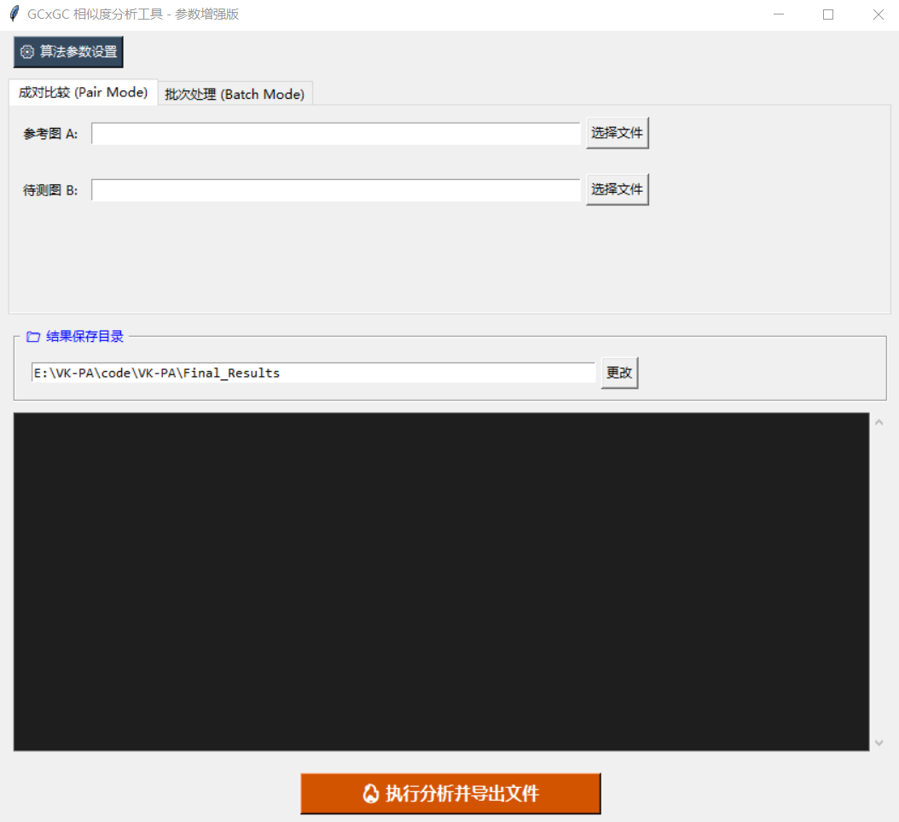
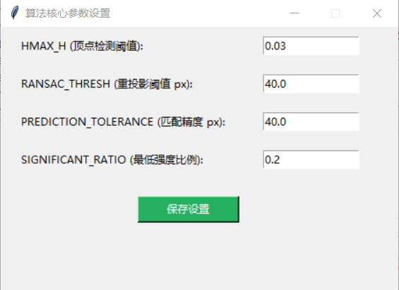
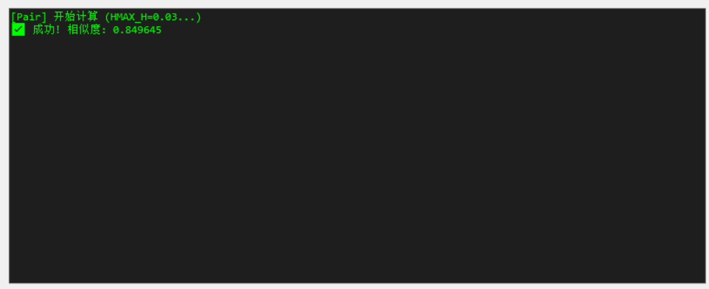

# Project Overview
 Visual Keypoint-Driven Registration of GC×GC Fingerprints for Quality Assessment and Origin Discrimination of Plant-Derived Products.
 # System Requirements
 Windows 10/11, 64-bit; at least 8 GB of RAM is recommended. The program runs offline without a separate Python installation or an NVIDIA GPU.
# How to Run and User Guide
- First, download and fully extract the portable package into a writable folder. Keep `VK-PA.exe` and the `_internal` folder together.
- Double-click `VK-PA.exe` and wait until the log indicates that the runtime is ready.
- For Pair Mode, select a reference image and a test image. For Batch Mode, select a folder containing the input images directly, with a unique filename stem for each image.
 
- If needed, open the algorithm settings, adjust the parameters, and save the settings. Defaults can be used for the first run. Record any changes, as settings reset when the program restarts.
 
- After completing the analysis settings, click “Run Analysis and Export Files.” The system will display the processing progress in real time and, upon completion, automatically open the folder containing the similarity report, alignment maps, and statistical data.
